<h1 align="center">Hi there, I'm Sushil Kumar Gupta 👋</h1>

  <b>Software Engineer</b> · Birgunj, Parsa, Nepal 
  Building trading-platform services, venue integrations, and operations tooling, plus AI agent infrastructure

  
  
  

<table align="center">
  <tr>
    <td><picture><source media="(prefers-color-scheme: dark)" srcset="assets/portrait-dark.svg"></picture></td>
    <td><picture><source media="(prefers-color-scheme: dark)" srcset="assets/card-dark.svg"></picture></td>
  </tr>
</table>

<picture><source media="(prefers-color-scheme: dark)" srcset="assets/heatmap-dark.svg"></picture>

<picture><source media="(prefers-color-scheme: dark)" srcset="assets/skyline-dark.svg"></picture>

Portrait, card and heatmap are SVGs in this repo; the heatmap and card refresh daily via GitHub Actions.

---

## `$ whoami` About Me

I'm a **Software Engineer** who builds and maintains production features, APIs, and integrations, then debugs defects through to release. At **GoQuant (Remote, Miami, USA)** I deliver a client-facing trading platform and an operations application:

- 📈 **Trading platform services** — order and market-data services, execution algorithms, and integrations with 6 venues
- ⚡ **Low-latency order flow** — Cap'n Proto over UDP across three services, **40% lower latency**
- 🔭 **Telemetry and observability** — Prometheus metrics and Loki logs for 7 services, with order-journey tracing
- 🧰 **Operations app** — team messaging, alerting and on-call, runbooks, and staffing dashboards
- 🧠 **MCP servers and editor rules** — for LLM-assisted development, **50% higher development productivity**

I work in Git with code review, unit and integration tests, and written handover notes.

Previously at **Codeinbound LLP** as a Full Stack Developer, building enterprise NMS (Network Management Systems) with real-time dashboards, SSH/RDP connectivity, and SNMP-based monitoring.

---

## `$ ls ~/stack` Tech Stack

### Languages

### AI / ML Frameworks & Tools

### Web & Backend

### Databases

### Cloud & DevOps

---

## `$ cat experience.log` Professional Experience

### 🏢 GoQuant — Software Engineer *(July 2025 – Present)*
*Remote | Miami, USA | High-Frequency Trading Tech*

**Trading platform**
- **Client-facing platform**: Built the web application and 3 API services in front of the order-management system. They validate and pre-check algorithm orders before sending them on, collect account and position data from venues, report fees, slippage, and execution savings against a VWAP benchmark, and stream account trading metrics to clients over WebSocket
- **Venue integrations**: Integrated 6 venues (Binance, OKX, Bybit, Hyperliquid, Deribit, and DEX) across order entry, market data, instrument metadata, and account, position, and reconciliation APIs. Developed execution algorithms (market, limit, TWAP, VWAP, and edge) that plan child orders from the order book
- **Low-latency order flow**: Moved orders, fills, and market-data subscriptions across three services onto Cap'n Proto over UDP — **40% latency improvement** across order placement, fill processing, and order-book updates
- **Observability**: Metrics and log collection for 7 services (Prometheus, and Promtail into Loki), plus order-journey logging to trace each order from placement through every stage, surfaced on the operations dashboard
- **Database**: PostgreSQL functions and stored procedures that join orders, trades, and billing tables and return aggregated rows in one call
- **MCP and AI-assisted development**: Modular MCP servers that let AI agents inspect databases, platform documentation, and API, WebSocket, and UDP traffic, plus Cursor rules and skills with the service layout, order flow, and debugging steps — **50% higher development productivity**
- **Quality**: Investigated production defects and security findings, wrote unit and integration tests around the fixes, and updated QA checklists and release notes. Delivered through Git feature branches and code review

**Operations app**
- **Team messaging and boards**: Channels, direct messages, threads, mentions, search, file sharing, and voice and video calls, plus Jira-style project boards for assigning and tracking work through a release
- **Infrastructure dashboard**: Prometheus service health, latency, order activity, and reconciliation, with live Loki logs, for one client trading stack
- **Alerts and on-call**: Alerts with timed escalation across primary and secondary on-call, runbooks, schedules, and push notifications on desktop and mobile
- **Staffing**: Dashboards for time worked, idle time, shifts, and leave, so managers can compare the schedule with who is active

### 🏢 Codeinbound LLP — Full Stack Developer (MERN) *(June 2024 – June 2025)*
*Remote | New Delhi, India*

- Replaced OpenNMS dependencies with custom service discovery, improving incident detection accuracy by **60%**
- Built interactive network topology builder reducing configuration errors by **40%**
- Designed real-time performance monitoring dashboards with SNMP integration, cutting incident resolution time by **60%**
- Implemented SSH/RDP connection features improving remote network management by **50%**
- Built dynamic PDF report generation with Puppeteer (tables, charts, graphs), improving analytical insight by **40%**
- Extracted server and database performance metrics with SNMP and exporters (PostgreSQL, MySQL, MongoDB, and Windows) and visualized them with gauges and graphs, improving monitoring efficiency by **80%**

---

## `$ ls ~/projects` Featured Projects

### 🌍 Hourbridge
> Timezone meeting planner built in one TypeScript codebase for the web, macOS, Windows, and iOS. Line up cities on a 24-hour grid, see working hours, nights, and public holidays, and pick a slot that is copied into a calendar invite. Time math is unit-tested, settings stay on the device, and the web app works offline.

**Stack:** TypeScript

---

### 🧰 Vibe setup
> Repeatable Claude Code setup so a new machine or cloud session gets the same skills, rules, agents, and commands. An installer pins each source and checks it before install, optional packs add role-based review and domain skills, and product-specific changes are saved as a profile and replayed later, with regression tests around the installer.

---

### 📈 ADA market-making strategy
> Rust quoting bot for ADA on a crypto exchange, with a fair-value model, post-only quotes, inventory limits, and fill attribution. A shadow test of inside-spread quotes showed a positive per-fill result after fees.

**Stack:** Rust

---

### 🤖 Autonomous AI Workflow Orchestrator
> LangGraph-based agent automation engine that decomposes high-level tasks into multi-step workflows with dynamic tool execution, memory, and guardrails

**Stack:** Python · LangGraph · LangChain · FastAPI · Docker

---

### 🔧 AI Agent Infrastructure (MCP Framework)
> Modular MCP framework enabling AI agents to securely inspect production databases, search exchange documentation, and analyze HTTP/WebSocket/UDP traffic with <0.1ms overhead. Handles ~2,300 async writes/sec across 5+ microservices.

**Stack:** Python · PostgreSQL · ChromaDB · SQLite · WebSocket · UDP · sentence-transformers

---

Earlier projects

### 💬 [AI Chat Agent](https://github.com/iprime2/ai-agent)
> Real-time AI chat app with prompt caching, tool orchestration, streaming responses. Reduced token costs by **30%** and improved response time by **40%**.

**Stack:** Next.js · TypeScript · LangChain · LangGraph · GPT-4o-mini · Clerk · Convex

### 🚀 [AI-SaaS Platform](https://github.com/iprime2/AI-SAAS)
> Multi-modal AI platform leveraging OpenAI + Replicate APIs for automated content generation. Boosted user productivity by **50%**, reducing manual workload by **30 hrs/week**.

**Stack:** Next.js · TypeScript · OpenAI · Replicate · Prisma · MySQL

---

## `$ cat education.txt` Education

**M.Sc. Computer Science** — MIT World Peace University, Pune *(August 2023 – May 2025)*
CGPA: 8.5

---

## `$ cat certifications.csv` Certifications

| Certification | Issuer | Year |
|---|---|---|
| AWS Cloud Quest: Cloud Practitioner | AWS Training & Certification | 2024 |
| Full-Stack JavaScript Development (MongoDB, Node, React) | LinkedIn Learning | 2023 |
| TypeScript Essential Training | LinkedIn Learning | 2023 |
| Back End Development Libraries | freeCodeCamp | 2022 |
| Front End Development Libraries | freeCodeCamp | 2022 |

---

## `$ git log --graph` Activity

  <picture>
    <source media="(prefers-color-scheme: dark)" srcset="https://raw.githubusercontent.com/iprime2/iprime2/output/snake-dark.svg">
    
  </picture>

  <picture>
    <source media="(prefers-color-scheme: dark)" srcset="assets/glyphs-dark.svg">
    
  </picture>

---

## `$ cat achievements.md` Achievements

- 🥇 **Certificate of Achievement** — Codeinbound LLP (2024) — Led 20% increase in project efficiency
- 🚀 **Smart India Hackathon** — Led a project that advanced to the next round with a blockchain-based land document digitization platform (MIT-WPU, 2023)

---

  <i>Open to AI/ML Engineer, Backend Engineer, and Full Stack Developer roles, globally and remotely</i>

